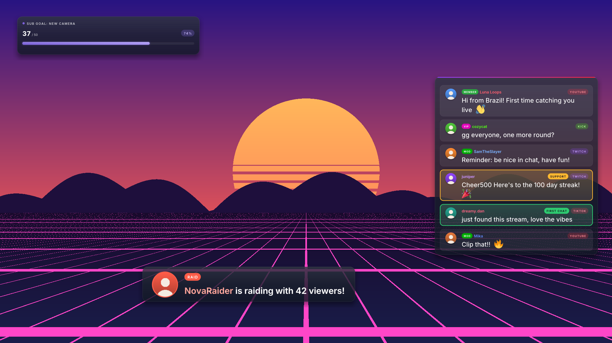
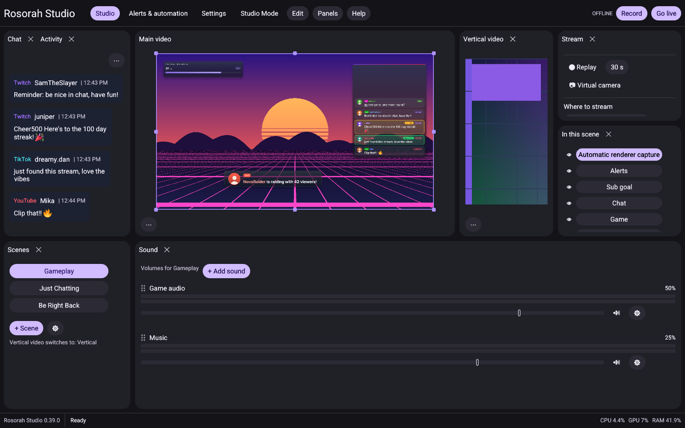
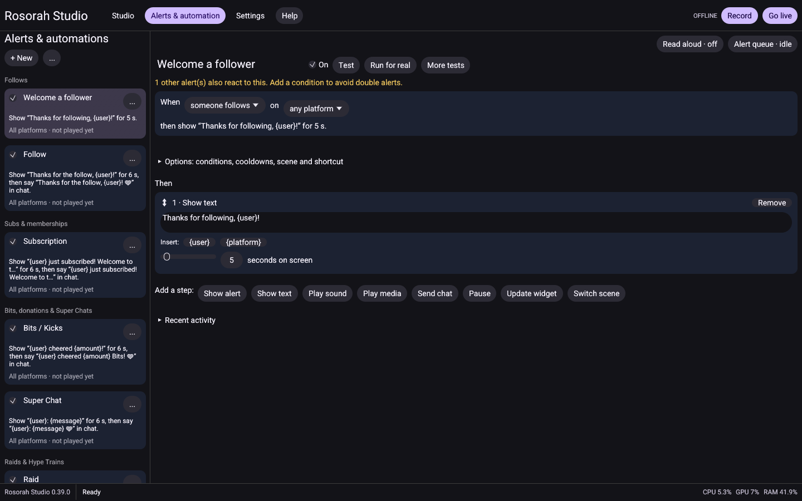
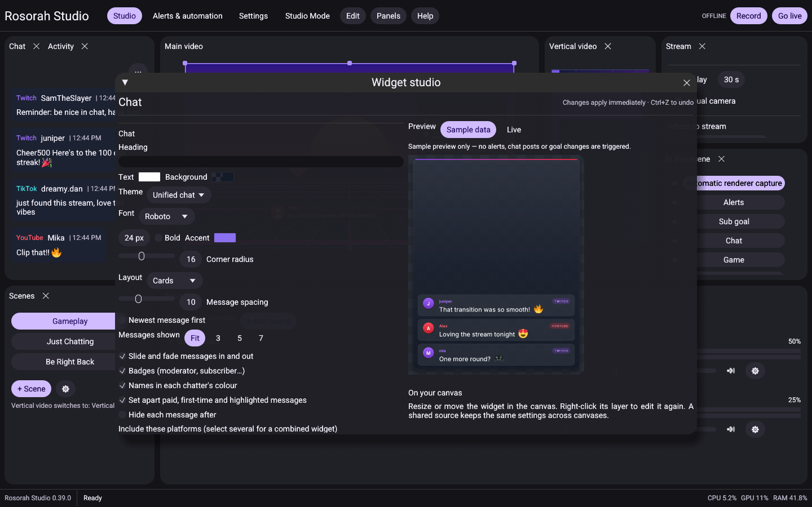
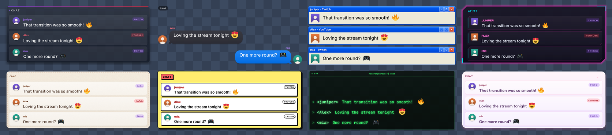
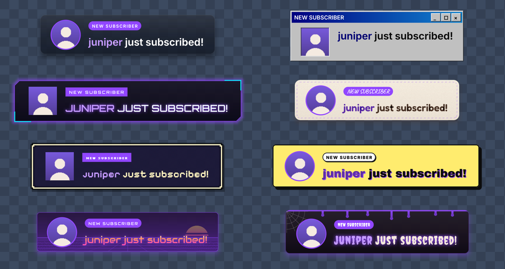

# Rosorah Studio

Free, open-source streaming and recording studio for **Windows and Linux**. It aims to be an
easier all-in-one alternative to running OBS, a chat bot and an alert service side by side:
scenes, multistreaming, unified chat, alerts and automations live in one app.

**[Download the latest release](https://github.com/iBustcherries/RosorahStudio-releases/releases/latest)**
· Windows 10/11 installer, Fedora `.rpm`, Ubuntu/Debian `.deb`

## What's new in 0.42.0

- **Updates inside Rosorah:** Help → **Check for updates…**, a check every few hours, and an update
  window that opens by itself once per new version (never while you're live). Turn the window off in
  Settings → Advanced → Updates to keep just the reminder at the bottom.
- **Install now on Linux** installs the update with your system's password prompt and offers
  **Restart now**.

## 0.41.0

- **Smoother game capture:** every frame of your stream and recording now gets a new game frame.
  Before, a 60 fps game could look closer to 30 fps.
- **Moving panels:** dragging a panel carries the whole panel under the pointer, and its old spot
  stays reserved until you let go. Drag a panel past the window edge to give it its own window.
- **Play media and Play sound steps** show just the file they play, and clips longer than 10 seconds
  play to the end.
- Games no longer fail to launch while Rosorah is open, and right-click menus on the canvas are
  no longer squashed into a narrow column.

## Screenshots

| | |
|---|---|
|  |  |
| **The studio** with unified chat, scenes, the canvas and the mixer | **Alerts & automation**: one list of alerts grouped by event |
|  |  |
| **Widget studio** with a live preview | **Chat widget** in a few of its themes |

*Names in these pictures are made up.*

## Features

- **Scenes and layers**: game, window, screen and camera capture, images, videos and playlists,
  browser sources, text with 68 bundled fonts, widgets, scenes inside scenes, crop, align and group
  tools, layer effects, colour correction, masks and a green-screen key.
- **Main and vertical videos**: a second canvas for TikTok, YouTube Shorts and Reels, with linked
  scenes.
- **Capture**: automatic game capture on Linux (Vulkan/OpenGL) and Windows (Windows Graphics
  Capture), PipeWire desktop and window capture, cameras and DroidCam, per-app sound.
- **Sound**: mixer with per-scene volumes, noise suppression, gate, compressor, EQ and more,
  monitoring, delay and six recording tracks.
- **Recording and streaming**: hardware encoders (AMD/NVIDIA, with a software fallback),
  multistreaming to Twitch, YouTube, Kick, TikTok and custom RTMP, a replay buffer, a Go live
  checklist and a virtual camera.
- **Accounts and chat**: Twitch, YouTube and Kick sign-in, titles and categories, automatic stream
  keys, unified Twitch/YouTube/Kick/TikTok chat with moderation, emotes and colour emoji.
- **Alerts and automations**: follows, subs, gifts, bits and Kicks, raids, channel points, Super
  Chats, donations (StreamElements, Streamlabs, Ko-fi) and chat commands trigger alerts, sounds,
  chat replies, scene switches and widget updates, and paid messages can be read aloud. Guided setup,
  built-in sounds and animations, bot accounts and timers.
- **Widgets**: chat, alerts, goals, now playing (follows your music app), timers, counters, polls,
  checklists, schedules, credits, QR codes and more, in 26 themes.
- **Studio Mode, transitions and projectors**: prepare a scene before sending it live; cut, fade,
  wipe, move and stinger transitions; projector windows and Multiview.
- **Hotkeys, remote control and scripts**: system-wide hotkeys, Stream Deck / Touch Portal / phone
  apps (including tools made for OBS), and sandboxed Lua scripts.
- **"I'm live" announcements** to Discord, Bluesky and Threads.
- **Projects**: profiles, automatic backups, recording recovery, and OBS and Firebot import.

See [the roadmap](docs/roadmap.md) for what's planned and current limits.

## Install

| System | File | Install |
|---|---|---|
| Windows 10/11 | `Rosorah-Studio-<version>-Setup.exe` | Run the installer (Windows may warn because it's unsigned) |
| Fedora 44 | `rosorah-studio-<version>-1.fc44.x86_64.rpm` | `sudo dnf install ./rosorah-studio-<version>-1.fc44.x86_64.rpm` |
| Ubuntu 24.04+ / Debian 13+ | `rosorah-studio_<version>-1_amd64.deb` | `sudo apt install ./rosorah-studio_<version>-1_amd64.deb` |

Each release includes `SHA256SUMS.txt`. Rosorah checks for new versions and can install them
for you (Settings → Advanced → Updates). Builds are unsigned.

## Build from source

Rust 1.90+, GStreamer (with the base plugins) and GLib/GIO development packages, pkg-config and a
native toolchain. Run `cargo build --release --locked`. The native capture source is under
`native/`, and the installer and package scripts are under `packaging/`.

## Privacy

Account connections are optional. See the [Privacy Policy](https://ibustcherries.github.io/Rosorah-Studio/privacy.html)
for how Rosorah handles account information, chat, recordings and connected services.

## License

Rosorah Studio's original project code is licensed under the [GNU General Public License, version 3 only](LICENSE) (`GPL-3.0-only`), except where a file or component carries a different license notice. You may use, modify, and redistribute the covered code under that license. Distributed binaries must be accompanied by corresponding source as required by GPLv3.

Third-party dependencies, vendored code, fonts, and media retain their respective licenses and notices. This license does not grant rights to third-party content you capture or stream, and does not require your recordings or broadcasts to be GPL-licensed merely because you created them with Rosorah.
